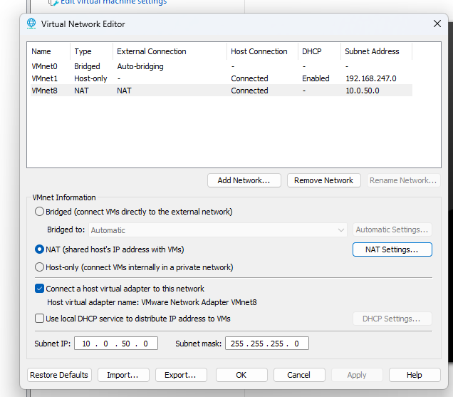
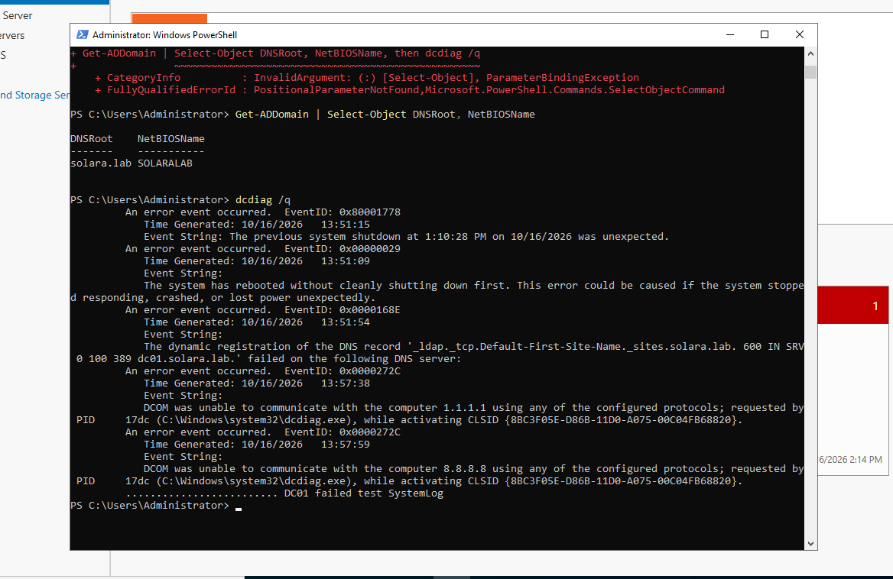
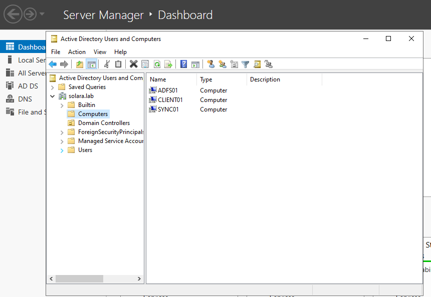
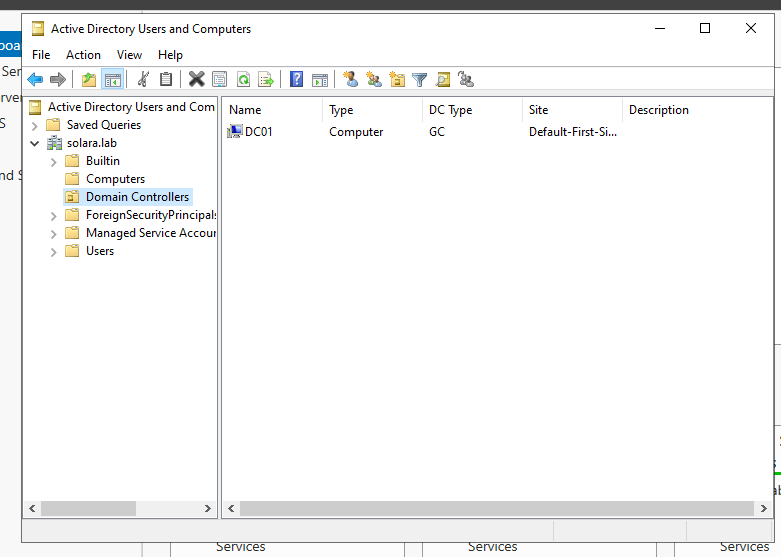
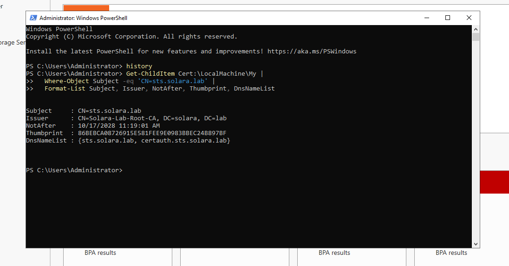
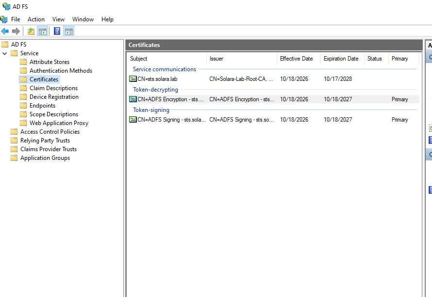
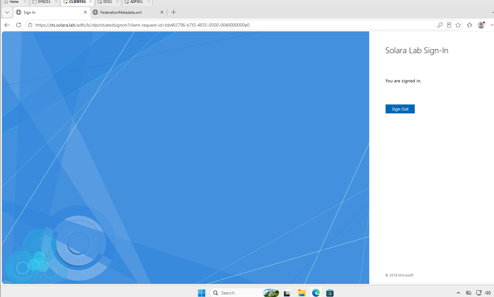

# Solara Hybrid IAM Lab

A hands-on hybrid identity lab that builds an on-premises Active Directory environment, federates a real SaaS app (Salesforce) through ADFS, syncs identities to Microsoft Entra ID, and then migrates Salesforce single sign-on from ADFS to Entra ID with a parallel run and rollback plan.

Built on VMware Workstation Pro as part of my transition into Identity and Access Management (IAM) engineering.

**Author:** Stephen Rembert

---

## Lab environment

| VM | OS | IP | Role |
| --- | --- | --- | --- |
| DC01 | Windows Server 2022 | 10.0.50.10 | Domain controller, DNS, certificate authority |
| ADFS01 | Windows Server 2022 | 10.0.50.12 | ADFS federation server |
| SYNC01 | Windows Server 2022 | 10.0.50.14 | Entra Cloud Sync agent |
| CLIENT01 | Windows 11 Enterprise | 10.0.50.20 | Domain-joined workstation |

- **Network:** isolated NAT subnet 10.0.50.0/24 (VMware VMnet8), gateway 10.0.50.2, DHCP disabled
- **Domain:** solara.lab
- **Cloud:** Microsoft Entra ID tenant (E5) and a Salesforce Developer Edition org

## Progress

- [x] Part 0 — Lab network
- [x] Part 1 — Build the Windows VMs
- [x] Part 2 — Active Directory forest
- [x] Part 3 — ADFS federation server
- [ ] Part 4 — Tiered OU structure and logon restrictions
- [ ] Part 5 — Users, groups and admin accounts
- [ ] Part 6 — Salesforce federated to ADFS
- [ ] Part 7 — Cloud IdP readiness
- [ ] Part 8 — Entra Cloud Sync
- [ ] Part 9 — Migrate Salesforce from ADFS to Entra ID

---

## Part 0 — Lab network

**What I built:** Reconfigured VMware's NAT network (VMnet8) as an isolated 10.0.50.0/24 lab subnet with DHCP turned off.

**Why it matters:** Active Directory depends on DNS. Clients locate domain controllers through DNS records, so the domain controller must be the only DNS source for lab machines. Disabling DHCP and assigning static addresses keeps name resolution under my control, the same way a production server subnet is managed.

**Proof:**

**Skills:** virtual networking, NAT, subnetting, DHCP/DNS fundamentals

---

## Part 1 — Build the Windows VMs

**What I built:** A patched Windows Server 2022 golden image, generalized with Sysprep and cloned into three servers (DC01, ADFS01, SYNC01), plus a Windows 11 Enterprise workstation (CLIENT01) with a virtual TPM. Each machine has a static IP, a defined role, and a baseline snapshot.

**Why it matters:** Enterprises deploy servers from a standard image rather than building each one by hand. Sysprep gives every clone a unique security identifier (SID), which Windows authentication depends on. Each role gets its own server because domain controllers, federation servers and sync servers have different security and support requirements.

**Proof:**

**Problems I hit and how I fixed them:**

- **Windows Update couldn't connect on the template.** The lab network has no DHCP and the template had no IP yet, so it had no route out. I temporarily switched the adapter to Bridged to patch it, then moved it back to NAT before running Sysprep.
- **A cloned VM wouldn't power on ("not enough physical memory").** The VM's memory allocation was larger than the host had free. I right-sized each VM's memory and ran only the VMs each task needed.
- **CLIENT01 couldn't ping DC01.** Both had correct IP settings, but Windows Server's firewall blocks inbound ICMP by default. I enabled the "File and Printer Sharing (Echo Request - ICMPv4-In)" rule on each server, and connectivity was confirmed.

**Skills:** Windows Server 2022, Windows 11, Sysprep and golden images, static IP configuration with PowerShell, Windows Firewall troubleshooting, VMware Workstation

**Scripts:** [`scripts/part1-configure-network.ps1`](scripts/part1-configure-network.ps1)

---

## Part 2 — Active Directory forest

**What I built:** Promoted DC01 to the first domain controller of a new forest, solara.lab (NetBIOS name SOLARALAB), with integrated DNS. I set DC01 as the authoritative time source for the domain and joined ADFS01, SYNC01 and CLIENT01 to the domain.

**Why it matters:** Every later part of this lab depends on Active Directory. The forest is the security boundary, the domain holds the identities, and DNS is how every machine finds the domain controller. The PDC Emulator role keeps time for the whole domain, and Kerberos authentication fails when clocks drift more than 5 minutes apart, so the time source is set deliberately instead of left to chance.

**Proof:**

**Problems I hit and how I fixed them:**

- **The external drive disconnected while DC01 was running.** All VMs live on an external SSD. When it dropped, DC01 crashed, and on reboot Windows ran a disk check. I let chkdsk finish, then confirmed the domain controller was healthy: the NTDS, DNS and Netlogon services were running, `ipconfig /registerdns` and a Netlogon restart re-registered its DNS records, and `dcdiag` passed. The remaining System Log errors came from the unexpected shutdown and cleared after an hour.
- **The drive came back with a different letter.** VMware couldn't find the VMs on the old drive letter. I reopened each .vmx from the new location and chose "I Moved It" so each VM kept its identity (MAC address and UUID) and stayed recognized by the domain.
- **VMs suspended on another PC wouldn't resume.** The saved state didn't match the new host's hardware, so I discarded the suspended state and did a clean boot. I also disconnected the CD/DVD drive from an ISO path that no longer existed.
- **Time was coming from the local CMOS clock.** `w32tm /query /source` showed the domain controller wasn't syncing with an external source. I reconfigured it to use time.windows.com and confirmed the source changed.
- **CLIENT01 failed to join ("domain could not be contacted").** DC01 was powered off. Without the domain controller there is no DNS for solara.lab and nothing to authenticate the join. After starting DC01 first, the join succeeded. Lesson: the domain controller is a dependency for everything, so it boots first.

**Skills:** Active Directory Domain Services, forest and domain design, AD-integrated DNS, FSMO roles and Windows Time (w32tm), domain join, dcdiag health checks, disaster recovery after an unexpected shutdown

---

## Part 3 — ADFS federation server

**What I built:** An enterprise certificate authority (Solara-Lab-Root-CA) on DC01, a TLS certificate for the federation service name sts.solara.lab, and a single-node ADFS farm on ADFS01 running under a group Managed Service Account (gMSA). I validated it from the domain-joined workstation with the federation metadata endpoint and an IdP-initiated sign-in.

**Why it matters:** ADFS lets Active Directory users sign in to cloud apps without the app ever seeing their password. ADFS checks the password, then hands the app a signed token that says "this user is verified." Many enterprises still run their single sign-on this way, and migrating off ADFS to Microsoft Entra ID is a common IAM project, so I built it first to understand what I'll be migrating in Part 9. The certificate proves the ADFS server is who it claims to be, and the gMSA means no person ever knows the service account's password.

**Proof:**

**Problems I hit and how I fixed them:**

- **ADFS didn't start after a reboot.** AD FS Management failed with error ADMIN0017 because the ADFS service was stopped. Even though DC01 was powered on first, ADFS01 booted before the domain controller was ready, so the service couldn't retrieve its gMSA password and gave up. I started the service manually, then set it to Automatic (Delayed Start) with automatic restart on failure so it recovers on its own. Lesson: a server being powered on isn't the same as its services being ready.

**Security notes:**

- The token-signing private key is the most sensitive secret in ADFS. Anyone who steals it can forge a sign-in as any user (the "Golden SAML" attack used in the SolarWinds breach), which is why ADFS servers are treated as Tier 0, the same as domain controllers.
- The CA runs on the domain controller as a lab shortcut. Production uses an offline root CA plus a separate issuing CA.

**Skills:** Active Directory Federation Services, SAML federation concepts, PKI and Active Directory Certificate Services, certificate templates, gMSA service accounts, DNS records for federation, Windows service recovery configuration
