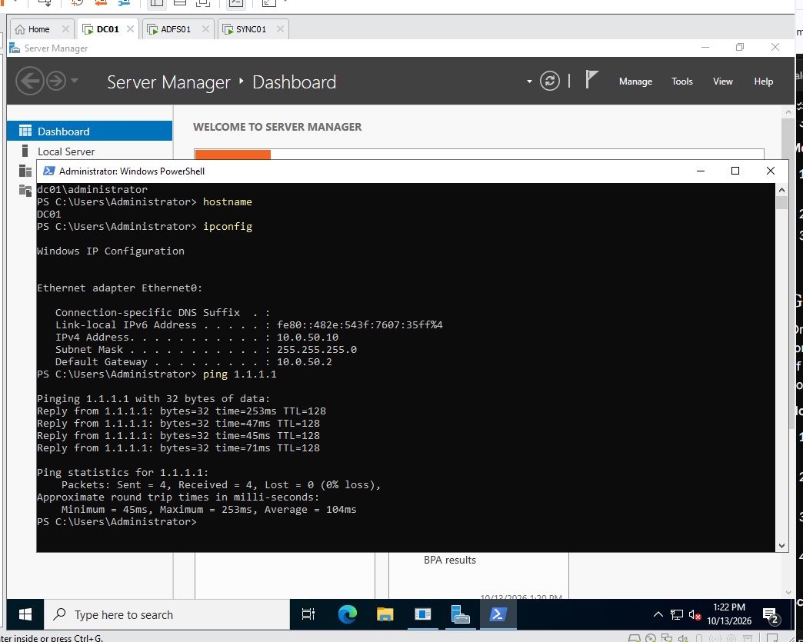
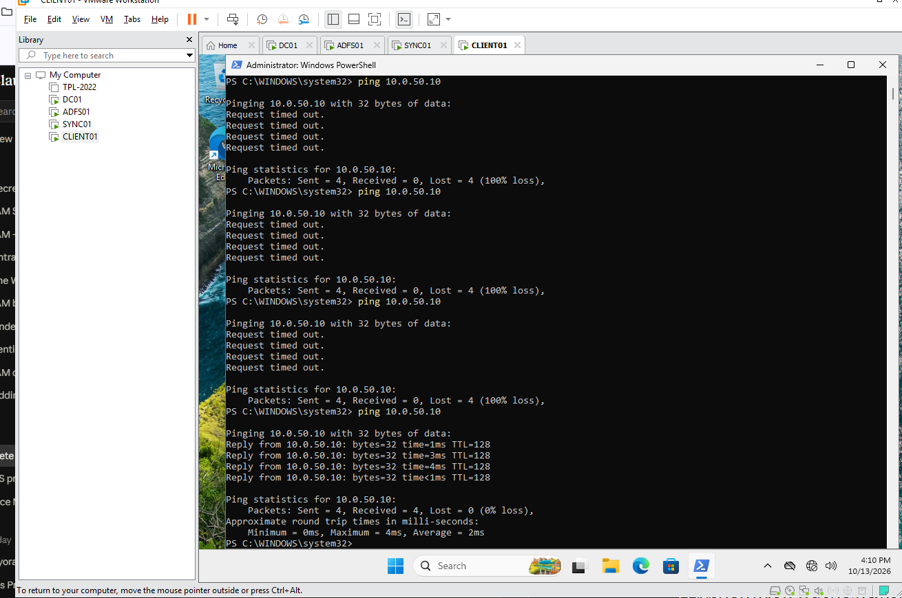

# Solara Hybrid IAM Lab

A hands-on hybrid identity lab that builds an on-premises Active Directory environment, federates a real SaaS app (Salesforce) through ADFS, syncs identities to Microsoft Entra ID, and then migrates Salesforce single sign-on from ADFS to Entra ID with a parallel run and rollback plan.

Built on VMware Workstation Pro as part of my transition into Identity and Access Management (IAM) engineering.

**Author:** Stephen Rembert

---

## Lab environment

| VM | OS | IP | Role |
| --- | --- | --- | --- |
| DC01 | Windows Server 2022 | 10.0.50.10 | Domain controller, DNS, certificate authority |
| ADFS01 | Windows Server 2022 | 10.0.50.12 | ADFS federation server |
| SYNC01 | Windows Server 2022 | 10.0.50.14 | Entra Cloud Sync agent |
| CLIENT01 | Windows 11 Enterprise | 10.0.50.20 | Domain-joined workstation |

- **Network:** isolated NAT subnet 10.0.50.0/24 (VMware VMnet8), gateway 10.0.50.2, DHCP disabled
- **Domain:** solara.lab
- **Cloud:** Microsoft Entra ID tenant (E5) and a Salesforce Developer Edition org

## Progress

- [x] Part 0 — Lab network
- [x] Part 1 — Build the Windows VMs
- [ ] Part 2 — Active Directory forest
- [ ] Part 3 — ADFS federation server
- [ ] Part 4 — Tiered OU structure and logon restrictions
- [ ] Part 5 — Users, groups and admin accounts
- [ ] Part 6 — Salesforce federated to ADFS
- [ ] Part 7 — Cloud IdP readiness
- [ ] Part 8 — Entra Cloud Sync
- [ ] Part 9 — Migrate Salesforce from ADFS to Entra ID

---

## Part 0 — Lab network

**What I built:** Reconfigured VMware's NAT network (VMnet8) as an isolated 10.0.50.0/24 lab subnet with DHCP turned off.

**Why it matters:** Active Directory depends on DNS. Clients locate domain controllers through DNS records, so the domain controller must be the only DNS source for lab machines. Disabling DHCP and assigning static addresses keeps name resolution under my control, the same way a production server subnet is managed.

**Proof:**

**Skills:** virtual networking, NAT, subnetting, DHCP/DNS fundamentals

---

## Part 1 — Build the Windows VMs

**What I built:** A patched Windows Server 2022 golden image, generalized with Sysprep and cloned into three servers (DC01, ADFS01, SYNC01), plus a Windows 11 Enterprise workstation (CLIENT01) with a virtual TPM. Each machine has a static IP, a defined role, and a baseline snapshot.

**Why it matters:** Enterprises deploy servers from a standard image rather than building each one by hand. Sysprep gives every clone a unique security identifier (SID), which Windows authentication depends on. Each role gets its own server because domain controllers, federation servers and sync servers have different security and support requirements.

**Proof:**

**Problems I hit and how I fixed them:**

- **Windows Update couldn't connect on the template.** The lab network has no DHCP and the template had no IP yet, so it had no route out. I temporarily switched the adapter to Bridged to patch it, then moved it back to NAT before running Sysprep.
- **A cloned VM wouldn't power on ("not enough physical memory").** The VM's memory allocation was larger than the host had free. I right-sized each VM's memory and ran only the VMs each task needed.
- **CLIENT01 couldn't ping DC01.** Both had correct IP settings, but Windows Server's firewall blocks inbound ICMP by default. I enabled the "File and Printer Sharing (Echo Request - ICMPv4-In)" rule on each server, and connectivity was confirmed.

**Skills:** Windows Server 2022, Windows 11, Sysprep and golden images, static IP configuration with PowerShell, Windows Firewall troubleshooting, VMware Workstation

**Scripts:** [`scripts/part1-configure-network.ps1`](scripts/part1-configure-network.ps1)
